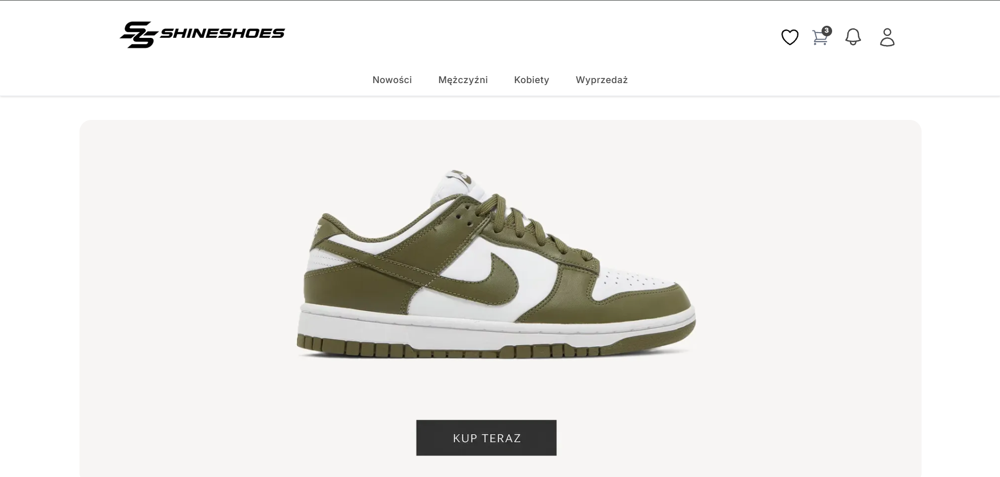
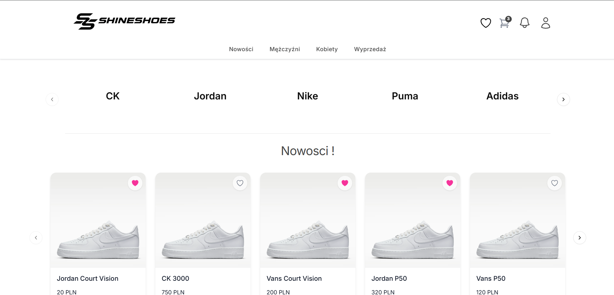
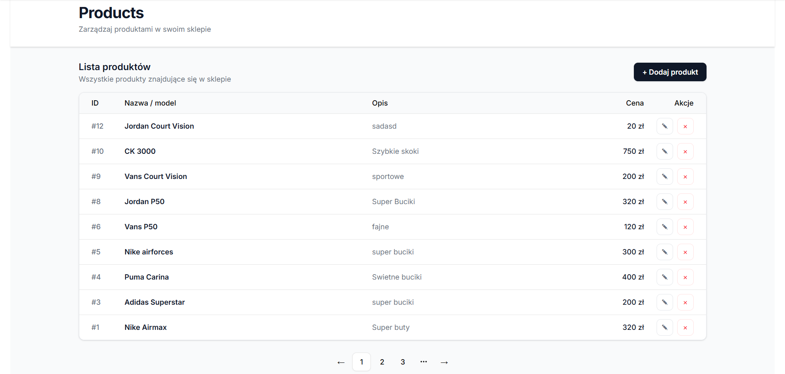

# 👟 ShineShoes

A full-stack e-commerce application for browsing and purchasing shoes.

## 🖥️ Screenshots

### Homepage
<p align="center">
  
</p>

### Main features
<table>
  <tr>
    <td width="50%">
      
      <p align="center"><b>Primary Site</b></p>
    </td>
    <td width="50%">
      
      <p align="center"><b>Favorites</b></p>
    </td>
  </tr>
  <tr>
    <td width="50%">
      
      <p align="center"><b>Admin Panel</b></p>
    </td>
    <td width="50%">
      
      <p align="center"><b>User profile</b></p>
    </td>
  </tr>
</table>
## Table of contents

- Login/Register
- Custom Exception
- Microservices
- Folder structure
- License
## Login/Register
    Director (UserDirector): Orchestrates the execution of the build process.

    Builder (UserBuilderInterface): Individual steps (e.g., password checking, JWT generation) implemented as modular components.
    
    Factory: Dynamically selects the required builders based on the action (Login vs. Registration).
    
    Key Features
    JWT Authentication: Secure token generation using jjwt.
    
    Stateless Security: Fully integrated with Spring Security for API protection.
    
    Modular Validation: Decoupled login checks (BCrypt) and email verification.
    
    Tech Stack
    Spring Boot 4 | Spring Security | JJWT | PostgreSQL

## Custom Exception
Custom Exception in GlobalExceptionHandler
```java
@ExceptionHandler(ShopException.class)
    public ResponseEntity<ExceptionDTO> handleShopException(ShopException ex)
    {
        ErrorCode error = ex.getErrorCode();
        BuildExceptionDTO builderDTO = new BuildExceptionDTO();
        ExceptionDTO dto = builderDTO.message(error.getMessage())
                .status(error.getStatus())
                .timestamp(LocalDateTime.now())
                .get();

        return ResponseEntity.status(error.getStatus()).body(dto);
    }
```
## Module
### Basket/Favorite Services
    A simple system for sending data from the frontend to a DTO,
    utilizing `@RequestBody` and `@AuthenticationPrincipal` for user authorization.
## Folder Structure
    frontend/
      - api/
      - assets/
      - components/
      - lib/
        
    src(backend)/
        - main/java/com.example.shineshoes/
            - core/
                - builders/
                    - user/
                    - login
                    - register
                - cache/
                - controllers/       
                - dto/     
                - exceptions/              
                - factory/
                - model/
                    - basket/
                    - favorite/
                    - product/
                - repository/
                - services/
            - security/
        - resources/
## License

This project is licensed under the MIT License — see LICENSE for details.
